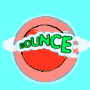

# Bounce Zero — Web Port

A browser port of **Bounce Zero**, rebuilt from scratch in TypeScript + [PixiJS](https://pixijs.com/) 8.

Roll a rubber ball through 11 single-screen levels. Collect every ring to unlock the exit, mind the spikes, and use the tile gadgets (deflators, inflators, gravity and jump arrows) to reach the door.

<p align="center">
  
</p>

## Play

```bash
npm install
npm run dev
```

Then open the printed local URL (default <http://localhost:5173>).

### Controls

| Action | Keyboard | Touch |
| --- | --- | --- |
| Move left / right | `←` `→` or `A` `D` | ◀ ▶ |
| Bounce / select | `Space`, `Enter`, `↑`, `Z` | ⬆ |
| Back / pause | `Esc`, `X`, `P` | II |
| Invincibility cheat | `Q` + `E` | — |

Menus use arrow keys to navigate and Enter/Space to confirm. On the level select, arrow keys move through a 5-column grid of the 11 levels.

### Scoring

| Pickup | Points |
| --- | --- |
| Ring (jump through a hoop) | 500 |
| Gem (sets your checkpoint) | 200 |
| Extra life | 1000 |
| Exit | 5000 |

Best level and best score persist in `localStorage`.

## Scripts

| Command | Description |
| --- | --- |
| `npm run dev` | Vite dev server with HMR |
| `npm run build` | Type-check (`tsc`) then build to `dist/` |
| `npm run preview` | Serve the production build locally |

## How it works

The original ran at a fixed 480×272 with 12px tiles. This port keeps the original geometry and constants so the physics feel identical, but renders at 2× (960×544) with vector-drawn tiles instead of the original sprite sheet.

**Fixed timestep.** Game logic runs at a hard 30Hz fixed step with an accumulator (max 4 catch-up steps per frame), decoupled from rendering. Rendering is whatever the display refreshes at, so physics stays deterministic across 60Hz, 120Hz and variable-refresh displays.

**Binary levels.** The 11 levels ship as raw binary blobs (`public/levels/J2MElvl.001`–`.011`), not JSON. `src/core/level.ts` parses them into a `Uint8Array` tile grid plus moving-object descriptors. Each tile byte packs an ID in the low 6 bits and flags (e.g. water) in the upper bits. Levels are cached and deep-copied on load so collected rings never pollute the cache.

**Tile table.** `src/core/tiles.ts` is a direct port of the original `tile_table.c`: each tile ID maps to a sprite index in the original 48×72 atlas, a transform (flip/rotate), and a render mode. Special tiles exist for the deflator, inflator, gravity-flip, jump-boost, speed-bonus, exit and checkpoint mechanics.

**OTT audio.** `src/core/audio.ts` contains a parser for Nokia's `.ott` ringtone format (ported from `sound.c`), decoded into a note list at load. Playback uses Web Audio sine oscillators with a short attack/release envelope — no samples needed. Audio unlocks on the first pointer or key press to satisfy browser autoplay policies.

**Rendering.** `src/render/` draws everything with PixiJS `Graphics` — tiles are baked once into `GraphicsContext`s at init, then blitted. Layers are split by what changes: background, static tiles, dynamic tiles, hazards, water, exit, ball, HUD and UI. A particle system (`particles.ts`) handles sparks, bubbles, dust and trail effects.

## Project layout

```
src/
  main.ts              boot, main loop, fixed-step accumulator, menu input
  core/
    constants.ts       tile IDs, physics tunables, palette, player state
    game.ts            game state machine, scoring, lives, level flow
    physics.ts         ball movement, collision, gravity, tile gadgets
    level.ts           binary level parser, tile accessors, moving objects
    tiles.ts           tile ID → sprite/transform/render-mode table
    masks.ts           pixel masks for ball and triangle sprites
    input.ts           keyboard + touch, PSP_CTRL-compatible edge detection
    audio.ts           .ott ringtone parser + Web Audio player
  render/
    renderer.ts        PixiJS app, layers, camera, HUD, menu drawing
    hd-tiles.ts        baked vector tile art
    particles.ts       particle system
public/
  levels/              11 binary level files
  sounds/              3 .ott ringtones
  assets/              original sprite sheet and splash images
```

## Credits

This is an unofficial reimplementation. All original materials — game design, level data, and art — belong to **Nokia** and/or **Sun Microsystems**, and are used here for research/preservation purposes only.

The level blobs (`public/levels/J2MElvl.*`) and the sprite assets in `public/assets/` are the original game's data files, unmodified. The `J2MElvl` naming points to the original J2ME release.

This repo currently has **no license file** — add one before distributing it.